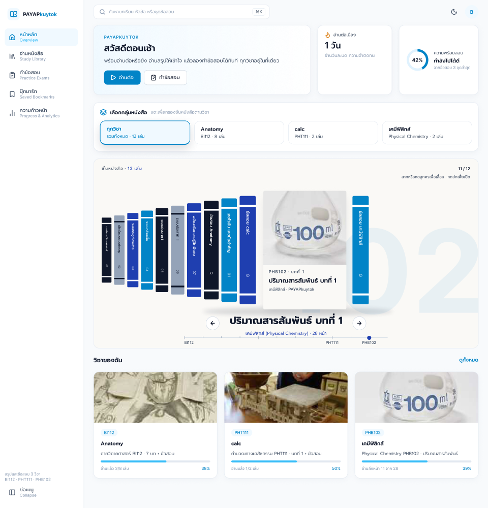
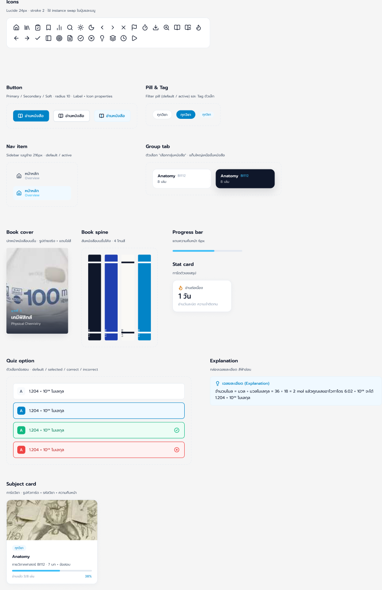

# PAYAPkuytok · Figma

ไฟล์ดีไซน์: https://www.figma.com/design/VHqSOyOGt3obrgpi5qVAUQ

- **Foundations**: ตัวแปรสี (Color) และ Spacing & Radius ตรงกับ `ui/base.css` เช่น `brand/primary` = `--pri-d` #0284C7, `brand/soft` = `--pri-s` #F0F9FF, `bg/page` #F8FAFC, `border/default` #E2E8F0, radius 16/10/9999
- **Text styles**: Prompt + Inter (Display/H1, Display/Sheet, Heading/H2, H3, Body, Label, Data)
- **Components**: Icon (Lucide), Button (Primary/Secondary/Soft), Pill, Nav item, Group tab, Book cover, Book spine, Progress bar, Stat card, Quiz option (4 สถานะ), Explanation, Subject card
- **Screens**: Desktop หน้าหลัก (หน้าอื่นยังไม่ได้พอร์ต เพราะติดโควตา Figma MCP แพลน Starter)

